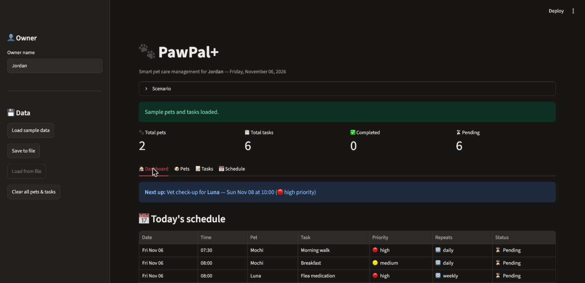

# 🐾 PawPal+ — Smart Pet Care Management System

PawPal+ is a Python application that helps a busy pet owner plan and track care tasks (walks, feeding, medication, grooming, vet visits…) for **multiple pets** at once. It has a reusable object-oriented backend, a command-line demo, and an interactive Streamlit web app.

*CodePath AI110 — Module 2 project.*

---

## Problem statement

Pet owners, especially those with more than one pet, find it hard to stay consistent with care routines. Tasks repeat every day or week, two pets can need attention at the same moment, and nothing reminds the owner what is still pending. PawPal+ keeps every pet's tasks in one place, builds a chronological schedule across all pets, warns about double-booked time slots, and automatically re-schedules recurring tasks when they are completed.

## Features

- **Multiple pets per owner**, each with name, species, optional breed and age.
- **Tasks** with a description, date, time, frequency (`once` / `daily` / `weekly`) and priority (`low` / `medium` / `high`).
- **Combined schedule across all pets.** The scheduler always reads tasks through `Owner.get_all_tasks()`.
- **Chronological sorting** by date, then time. There is also an optional **priority sorting** mode (high → low, then time).
- **Filtering** by pet, by completion status and by date. Filters can be combined.
- **Recurring tasks:** completing a daily or weekly task creates its next occurrence and keeps the completed one as history. Completing a task twice never creates a duplicate.
- **Conflict detection:** readable warnings when two or more pending tasks share the exact same date and time, for the same pet or for different pets.
- **Input validation:** clear `ValueError` / `TypeError` messages for empty names, bad times, unknown frequencies, and so on.
- **Streamlit dashboard** with metrics, today's schedule, conflict warnings, pet and task management, and schedule filters.
- **JSON save/load** (optional extension) from the Streamlit sidebar.
- **79 automated pytest tests.**

## Technologies used

| Tool | Purpose |
|------|---------|
| Python 3.10+ (developed on 3.12) | Language. Uses `dataclasses`, `datetime`/`timedelta`, `json`, `uuid` from the standard library |
| Streamlit | Web user interface |
| pytest | Automated testing |
| Mermaid | UML class diagrams |

## Project structure

```
PawPal-Plus/
├── pawpal_system.py      # Backend: Task, Pet, Owner, Scheduler
├── main.py               # CLI demonstration
├── app.py                # Streamlit web app
├── tests/test_pawpal.py  # pytest suite
├── diagrams/
│   ├── uml_draft.mmd     # Initial design
│   ├── uml_final.mmd     # Final design (matches the code)
│   └── uml.mmd           # Identical copy of uml_final.mmd (grading file name)
├── assets/dashboard.jpg  # Screenshot of the running Streamlit app
├── pytest.ini            # Lets plain `pytest` find pawpal_system.py
├── requirements.txt
├── reflection.md
└── ai_interactions.md
```

## Architecture

```
            ┌───────────────┐
 app.py ──▶ │   Scheduler   │ ──reads via get_all_tasks()──▶ ┌─────────┐ 1 ── * ┌───────┐ 1 ── * ┌────────┐
 main.py ─▶ │ sort / filter │                                 │  Owner  │───────▶│  Pet  │───────▶│  Task  │
            │ conflicts     │                                 └─────────┘        └───────┘        └────────┘
            │ recurrence    │
            └───────────────┘
```

The UI layers (`app.py`, `main.py`) contain **no scheduling logic**. They create objects and call backend methods.

### Class descriptions

| Class | Responsibility | Key methods |
|-------|----------------|-------------|
| `Task` (dataclass) | One care activity. Validates its own data on creation. | `mark_complete()`, `is_recurring()`, `next_occurrence()`, `to_dict()` / `from_dict()` |
| `Pet` (dataclass) | A pet and its list of tasks. Sets each task's `pet_name` when added. | `add_task()`, `get_tasks()`, `get_pending_tasks()`, `get_completed_tasks()`, `remove_task()` |
| `Owner` (dataclass) | The owner and their pets. Pet names are unique (case-insensitive). | `add_pet()`, `get_pets()`, `get_pet()`, `remove_pet()`, **`get_all_tasks()`**, `save_to_json()` / `load_from_json()` |
| `Scheduler` | The scheduling engine. Holds a reference to the `Owner` and never keeps its own copy of tasks. | `sort_by_time()`, `sort_by_priority()`, `filter_tasks()`, `filter_by_pet/status/date()`, `get_daily_schedule()`, `detect_conflicts()`, `complete_task()`, `get_recurring_tasks()`, `get_summary()` |

### UML

- Draft (initial design): [diagrams/uml_draft.mmd](diagrams/uml_draft.mmd)
- **Final (authoritative, matches the code):** [diagrams/uml_final.mmd](diagrams/uml_final.mmd)
- [diagrams/uml.mmd](diagrams/uml.mmd) is an identical copy of the final diagram. It is kept because the course's grading setup expects that file name.

You can paste either file into <https://mermaid.live> to see the diagram.

---

## Installation (macOS)

Run these from the project folder. The folder path may contain spaces, so wrap it in quotes when you `cd`.

```bash
cd "/path/to/PawPal-Plus"
python3 -m venv .venv
source .venv/bin/activate
python -m pip install --upgrade pip
pip install -r requirements.txt
```

On Windows, activate with `.venv\Scripts\activate` instead.

## How to run

Activate the virtual environment first (`source .venv/bin/activate`) in every new terminal window.

**CLI demo**

```bash
python main.py
```

**Streamlit app**

```bash
streamlit run app.py
```

Open **<http://localhost:8501>** in your browser. **Keep that terminal open:** the app only works while the `streamlit run` command is running. Press `Ctrl+C` in the terminal to stop it.

**Tests**

```bash
python -m pytest -v
```

### Troubleshooting: "localhost refused to connect" (ERR_CONNECTION_REFUSED)

This browser error means **no Streamlit server is running** on that port. Typical causes:

- `streamlit run app.py` was never started, or its terminal was closed or stopped with `Ctrl+C`.
- The server started on a different port, because 8501 was already busy. Use the `Local URL` that Streamlit prints.

Fix it by starting the server and leaving the terminal open:

```bash
source .venv/bin/activate
python -m streamlit run app.py --server.port 8501
```

To check what is using port 8501: `lsof -nP -iTCP:8501 -sTCP:LISTEN`.

---

## 📐 Smarter Scheduling

| Feature | Method(s) | Notes |
|---------|-----------|-------|
| Task sorting | `Scheduler.sort_by_time()`, `Scheduler.sort_by_priority()` | Sorts by `(date, time)`. Priority mode sorts by `(priority rank desc, date, time)`. Returns a new list, so the original order is unchanged. |
| Filtering | `Scheduler.filter_tasks(pet_name, completed, on_date)` and the `filter_by_pet/status/date` shortcuts | Works across all pets. Filters can be combined. Pet names are case-insensitive. |
| Conflict handling | `Scheduler.detect_conflicts()` | Groups pending tasks by exact `datetime`. Any group of 2+ becomes one warning string. Never raises. |
| Recurring tasks | `Task.next_occurrence()`, `Scheduler.complete_task()` | Daily = +1 day and weekly = +7 days (`timedelta`). The original stays as completed history. Duplicate-safe. |

### Recurrence behavior

`Scheduler.complete_task(task_id)` does the following:

1. Calls `task.mark_complete()`. This returns `True` only the first time. If the task was already completed, nothing else happens and `None` is returned.
2. For `daily`/`weekly` tasks, `task.next_occurrence()` builds a new pending `Task` with the same description, time, priority and pet, dated +1 or +7 days, with a new `task_id`.
3. As a second safety check, the new task is only added if that pet does not already have a task with the same description, date and time.
4. The new task is returned, so the UI can say "Next occurrence scheduled for …". The completed original stays in the pet's list as history.

One-time (`once`) tasks are simply marked complete.

### Conflict detection behavior

- Tasks have **no duration**, so the algorithm checks **exact date + time matches**, not overlapping time ranges. For example, a walk at 08:00 and a feeding at 08:15 are not reported as a conflict.
- It works for tasks of the **same pet** (`[same pet (Mochi)]`) and of **different pets** (`[different pets]`).
- Completed tasks are ignored by default, because they no longer need the owner's time. Pass `include_completed=True` to include them.
- Three or more tasks in the same slot produce **one** warning that lists all of them.
- It returns a list of messages, for example:
  `Conflict on 2026-11-06 at 08:00 [different pets]: 'Breakfast' (Mochi), 'Flea medication' (Luna)`

---

## 📸 Demo walkthrough

1. Run `streamlit run app.py`. The header shows four metrics (Total pets, Total tasks, Completed, Pending), all at 0.
2. In the sidebar, set the **Owner name**. Either click **Load sample data** (two pets, six tasks) or open the **🐶 Pets** tab and add a pet with the form (name, species, optional breed and age). An empty name shows a red validation error.
3. In the **🐶 Pets** tab, each pet has a card with its species, breed, age, and pending and completed counts. Choose a pet in **Select a pet to view its tasks** to see that pet's tasks in time order.
4. In the **📝 Tasks** tab, use **Add a task**: pick the pet, enter a title, date, time, frequency and priority. If the new task lands on the same date and time as another pending task, a yellow warning appears instead of the green success message.
5. Still in **📝 Tasks**, pick a pending task and click **✅ Mark complete**. For a daily or weekly task, the success message (a banner plus a pop-up toast) names the date of the next occurrence. The task moves to the *Completed* table and the new occurrence appears under *Pending*.
6. In the **📅 Schedule** tab, filter by pet, status (All/Pending/Completed) and date (All/Today/Pick a date), and sort by *Time* or *Priority, then time*. Below the table are the conflict check and the list of recurring tasks.
7. The **🏠 Dashboard** tab shows a **Next up** banner (the earliest pending task that isn't in the past), today's schedule with a progress bar, today's conflicts, and pending tasks for the next 7 days.
8. Optionally, click **Save to file** to write `pawpal_data.json`, and **Load from file** to restore it later. The file is git-ignored.

**Screenshot:** the dashboard after clicking *Load sample data*, captured from the running app at `http://localhost:8501`.



## 🖥️ Sample CLI output

Excerpt from `python main.py`. The dates are always "today", so yours will differ.

```
========================================================================
  PawPal+  |  Smart Pet Care Management
========================================================================
  Owner: Jordan
  - Mochi: dog, Shiba Inu, age 3  (3 tasks)
  - Luna: cat, Siamese, age 5  (3 tasks)

  The scheduler read 6 tasks across 2 pets through Owner.get_all_tasks().

========================================================================
  Today's Schedule  (Friday, November 06, 2026)  - sorted by time
========================================================================
  Date        Time   Pet       Task                    Priority  Repeat  Status
  ----------  -----  --------  ----------------------  --------  ------  -------
  2026-11-06  07:30  Mochi     Morning walk            high      daily   Pending
  2026-11-06  08:00  Mochi     Breakfast               medium    daily   Pending
  2026-11-06  08:00  Luna      Flea medication         high      weekly  Pending
  2026-11-06  12:00  Luna      Brush fur               low       once    Pending
  2026-11-06  18:30  Mochi     Evening walk            high      daily   Pending

========================================================================
  Conflict detection
========================================================================
  WARNING: Conflict on 2026-11-06 at 08:00 [different pets]: 'Breakfast' (Mochi), 'Flea medication' (Luna)

  Added 'Play fetch' for Mochi at 18:30 (same time as 'Evening walk')...
  WARNING: Conflict on 2026-11-06 at 08:00 [different pets]: 'Breakfast' (Mochi), 'Flea medication' (Luna)
  WARNING: Conflict on 2026-11-06 at 18:30 [same pet (Mochi)]: 'Evening walk' (Mochi), 'Play fetch' (Mochi)

========================================================================
  Recurring tasks: completing tasks
========================================================================
  Completed 'Morning walk' (daily) -> next occurrence created for 2026-11-07 at 07:30
  Completed 'Flea medication' (weekly) -> next occurrence created for 2026-11-13 at 08:00
  Completed 'Brush fur' (once) -> one-time task, nothing new created
  Completed 'Morning walk' a second time -> ignored, no duplicate created
```

The full output also shows the unsorted list, the priority-sorted schedule, filters by pet, date and status, and a final summary.

## 🧪 Testing PawPal+

```bash
python -m pytest -v
```

The suite in `tests/test_pawpal.py` (79 tests) is grouped into:

| Group | What it checks |
|-------|----------------|
| `TestTask` | Creation and defaults, string/`date`/`time` inputs, normalisation, `mark_complete()`, unique ids, readable `str()` |
| `TestValidation` | Invalid time, date, frequency, priority and description. Invalid pet/owner data, wrong types, duplicate pets/tasks, unknown task id |
| `TestPetAndOwner` | Adding pets and tasks, multiple pets, pending/completed lists, removal, `Owner.get_all_tasks()` aggregation |
| `TestScheduler` | Retrieval through the owner, chronological and priority sorting, filters (pet / status / date / combined), daily schedule, empty schedules, summary |
| `TestRecurrence` | Daily (+1 day) and weekly (+7 days), month boundary, history kept, no duplicates when completed twice, one-time tasks, chained occurrences |
| `TestConflicts` | Same pet, different pets, no false positives (different times or different dates), empty list, 3-way conflict, completed tasks ignored |
| `TestPersistence` | JSON save/load round trip |

Latest result (Python 3.12.15, pytest 9.2.0):

```
============================== 79 passed in 0.04s ==============================
```

**Other checks performed:** `python main.py` runs without errors. `py_compile` succeeds for all files. `pyflakes`, `flake8 --max-line-length 120` and `ruff check` report no issues. `python -m streamlit run app.py --server.port 8501` starts: `/_stcore/health` returns `ok` and `/` returns HTTP 200. The page was then opened in Chrome. Loading the sample data, completing a recurring task (the task count went from 6 to 7, with 1 completed), the toast message and the pet cards all worked in the live app. The UI flows were also driven headlessly with Streamlit's `AppTest`: add a pet, see the validation error, add conflicting tasks, complete a recurring task, load sample data, filter, and save/load.

## Known limitations

- Conflict detection checks exact time matches only, because tasks have no duration.
- Data lives in memory (Streamlit session state) unless you click **Save to file**.
- The UI cannot edit or delete individual tasks yet. `Pet.remove_task()` exists in the backend but is not wired to a button.
